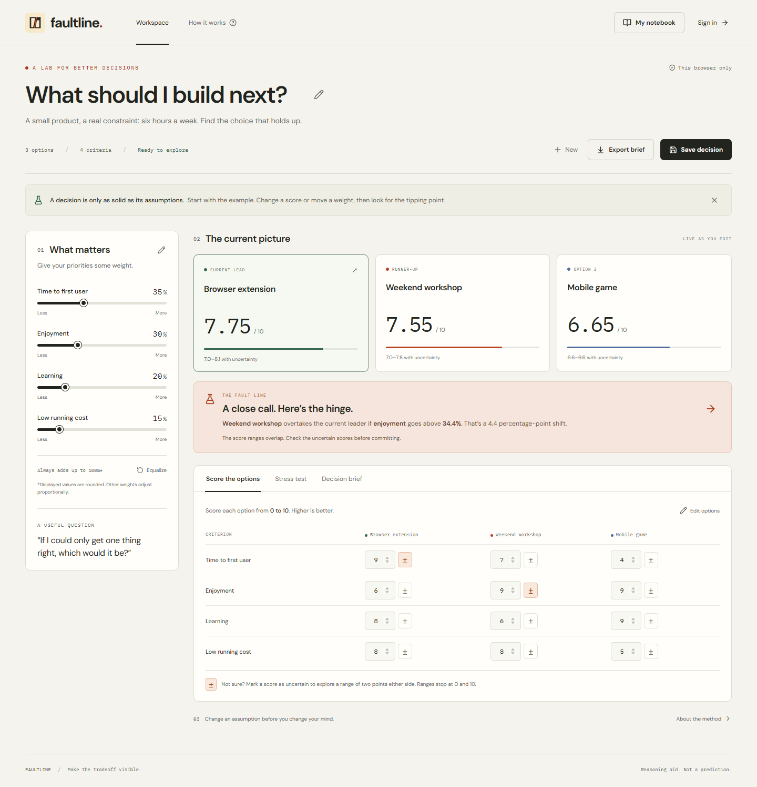

# WHATCODEXCAN — Faultline

**I gave Codex a challenge, not a product idea. This repository is what it built.**

I wanted to see how far an AI coding agent could take an open-ended prompt: choose an original idea, design it, build it, connect a real backend, test it, and deliver something usable. I did not provide the idea for Faultline, a starter application, wireframes, or an implementation plan. I supplied the process, required tools, hardware constraints, and quality bar.

Codex proposed three directions, selected Faultline, and built the application from scratch using existing frameworks and SDKs. It handled the product specification, Figma design, Canva branding, interface copy, frontend, Supabase schema and authentication, access-control policies, tests, fixes, and documentation. I asked it to continue when usage limits interrupted the work, then asked it to publish the result here.

**This run used OpenAI Codex.** The prompt can be reused to compare other coding agents, including Claude, but this repository contains no Claude run or measured head-to-head comparison. It records one experiment and its actual results.

[Original challenge and evaluation criteria](docs/EXPERIMENT.md) · [Verification report](docs/VERIFICATION.md) · [Two-minute demo](docs/DEMO.md)



## What is Faultline?

Faultline is a **decision stress lab**. It helps you compare a few options and find the assumption that could change your decision.

A normal weighted comparison gives you a winner. Faultline also asks: _How much would one priority have to change before another option overtakes it?_ You can mark scores you are unsure about, try a different weighting without changing your saved decision, and keep the reasoning alongside the numbers.

It is useful for choices such as which side project to build, which prototype to test, or how to spend a limited amount of time. It does not generate AI advice or predict which choice will succeed. The calculations are deterministic and run in your browser.

Weighted decision analysis already exists. The product's contribution is the combination of exact tipping points, explicit uncertainty, interactive scenarios, and a portable decision brief. This experiment does not claim research novelty or that no similar product exists.

## How it works

### 1. Define the question and options

Create a question, add some context, and compare **2–4 options** using **2–6 criteria**. Frame every criterion so a higher score means better. For example, use “low running cost” rather than “cost,” so a score of 10 consistently means a strong result.

Non-negotiable requirements should eliminate unsuitable options before scoring. A weighted average can otherwise let strength in one area compensate for a deal-breaker in another.

### 2. Give each criterion a weight and each option a score

Weights express what matters to you. Scores from **0 to 10** express how well each option meets each criterion. Faultline normalizes the weights and computes:

```text
option total = sum(score for each criterion × normalized criterion weight)
```

The included example compares a browser extension, a weekend workshop, and a mobile game. With weights of 35%, 30%, 20%, and 15%, their totals are:

| Option            | Weighted total |
| ----------------- | -------------: |
| Browser extension |      7.75 / 10 |
| Weekend workshop  |      7.55 / 10 |
| Mobile game       |      6.65 / 10 |

Moving one weight adjusts the others proportionally. If all other weights were zero, the remaining weight is distributed equally. Displayed percentages are rounded; calculations retain their underlying precision.

### 3. Find the tipping point

For each criterion, Faultline varies its weight while keeping the proportions of the other weights fixed. Each option's total then follows a straight line, so the crossing point can be solved directly instead of estimated by a simulation.

In the example, the workshop overtakes the extension when the Enjoyment weight rises above **34.375%**, displayed as **34.4%**. That is a change of only **4.375 percentage points** from the initial 30% weight. At the exact crossover, the two options tie.

The workspace highlights the nearest crossover against the current leader. **Explore tipping point** opens that exact scenario. The chart and ranking update as you move the scenario slider; **Use these weights** explicitly applies the scenario to the decision. Merely exploring it does not change the baseline.

### 4. Keep uncertainty visible

Mark an uncertain score with the ± control. Faultline treats that score as a range of **two points either side**, clipped to 0–10, and computes lower and upper weighted totals.

These are bounds, not probabilities or confidence intervals. Overlapping ranges are a reason to investigate the inputs. They do not say that an option has a particular chance of winning. Weight sensitivity changes one criterion at a time; it does not search every combination of assumptions.

### 5. Save the decision and its reasoning

Write what the model misses in the **Decision brief**. Then save, reopen, update, duplicate, or delete the decision. Download a Markdown brief containing the question, inputs, rankings, uncertainty ranges, nearest tipping point, notes, and method.

There are two separate storage modes:

| Mode              | Where the data lives                                       | What to expect                                                                                                               |
| ----------------- | ---------------------------------------------------------- | ---------------------------------------------------------------------------------------------------------------------------- |
| This browser only | localStorage in the current browser profile and origin     | Works without backend setup. Drafts persist locally; clearing browser data removes them.                                     |
| Private notebook  | Local Supabase PostgreSQL, behind an authenticated account | Explicit saves, ownership-enforced access, and revision checks. Unsaved account drafts stay in memory and clear on sign-out. |

Signing in preserves the current guest decision so you can save it to your account. It does not upload the whole browser notebook. `localhost` and `127.0.0.1` are different browser origins, so use the same URL consistently.

## Run it locally

Requirements: **Node.js 22.19.0**, npm 10+, and a modern browser. The app needs no GPU, local model, AI API key, or paid service.

```sh
git clone https://github.com/Logesh-vr/WHATCODEXCAN.git
cd WHATCODEXCAN
npm ci
npm run dev
```

Open **http://127.0.0.1:5173/**. The browser-only workflow is usable immediately.

For accounts, the verified Windows path uses WSL 2 Ubuntu with systemd and Docker Engine. After installing and initializing WSL Ubuntu, run:

```powershell
powershell -NoProfile -ExecutionPolicy Bypass -File scripts/install-wsl-backend.ps1
npm run backend:start
```

Keep that terminal open. In a second terminal, from the project root:

```powershell
npm run setup:env
npm run dev
```

The installer pins and verifies Supabase CLI 2.121.0. The first backend start downloads its containers and applies the migrations. The environment helper writes only the local URL and public client key; `.env.local` is ignored by Git. Restart an already running frontend after configuring it.

This local development stack confirms signup immediately and sends no real email. Stop it with `npm run backend:stop`; database volumes are retained. **[Full setup, alternative environments, and troubleshooting](docs/SETUP.md)** cover the complete process.

## Under the hood

```text
React workspace → TypeScript decision engine → ranking, ranges, and crossovers
       │
       ├─ Browser notebook → localStorage
       │
       └─ Account notebook → Supabase Auth + PostgREST → PostgreSQL + RLS
```

- **React, TypeScript, and Vite** provide the interface and local build. Fonts, icons, and the Canva mark are bundled; no runtime font CDN or analytics is used.
- **Zod** validates versioned decision documents in the client. PostgreSQL validates document shape, lengths, IDs, weight and score bounds, and score completeness independently.
- **Supabase Auth** provides email/password sessions. Each saved decision is a JSONB document tied to its owner, with timestamps and a revision number.
- **Row-level security (RLS)** is enabled and forced. Separate policies restrict reads, inserts, updates, and deletes to the authenticated owner. Column grants prevent ownership reassignment.
- **Optimistic concurrency** requires an account update to match the revision that was loaded. The database increments versions consistently; a stale save keeps the draft and asks the user to reopen the newer version or save a copy.

| Location                                                     | Responsibility                                                |
| ------------------------------------------------------------ | ------------------------------------------------------------- |
| `src/model.ts`                                               | Document types, validation, starter example                   |
| `src/engine.ts`                                              | Weighted scores, uncertainty bounds, exact crossovers, export |
| `src/storage.ts`                                             | Browser and account persistence, revision checks              |
| `src/App.tsx`                                                | Workspace state and interactions                              |
| `src/Editor.tsx`, `Auth.tsx`, `Modal.tsx`, `StressChart.tsx` | Editing, account, dialog, and chart components                |
| `supabase/migrations/`                                       | Schema, validation functions, policies, update trigger        |
| `scripts/`                                                   | Setup, backend lifecycle, integration checks, measurements    |
| `tests/`                                                     | Calculation and browser coverage                              |

## What was verified?

The completed local run passed **9 unit tests, all 8 browser tests, and 16 real backend checks**. Those include sign-up/sign-in, private persistence, failed-save recovery, copy/delete, another account being unable to access a decision, forged ownership rejection, and stale-write protection. Database lint and Supabase security advisors passed without reported warnings at the configured threshold.

Desktop and mobile layouts were inspected. Automated accessibility checks passed on the tested workspace, editor, scenario, brief, signup, and notebook screens. A clean dependency install and production build also passed.

```sh
npm run format:check
npm test
npm run build
npm run test:e2e
npm run test:backend
npm run test:accounts
```

The last two commands require the local backend; the account browser test also needs frontend configuration. The normal browser suite and GitHub CI skip the account test unless explicitly enabled. CI runs formatting, unit tests, the build, and browser-only flows without secrets. The [verification report](docs/VERIFICATION.md) separates those checks from the real local backend evidence.

The final production JavaScript bundle was about **138.6 kB gzip**. Five local browser measurements recorded a median main-content paint of **168 ms**, with a **136–1,020 ms** range, and roughly **4.7 MB** JavaScript heap. The four backend containers used approximately **235 MiB** at the recorded snapshot; WSL's reported memory use was about **919 MiB**. These were measured on the available **Ryzen 7 7435HS / 24 GiB** host, not a separate benchmark on the requested Intel machine. [Raw measurements](docs/measurements/frontend.json) and methodology are included.

## Design, tools, and honest limits

| Requested tool | What actually happened                                                                                                                                                                                                          |
| -------------- | ------------------------------------------------------------------------------------------------------------------------------------------------------------------------------------------------------------------------------- |
| Figma          | An actual editable file was created before implementation, with tokens, type styles, component states, desktop/mobile views, and notebook/account screens. [Open Figma](https://www.figma.com/design/65uiJ7BzskfCThgA7mqP5F).   |
| Canva          | An original mark was generated and its supplied 200px image was used in the app. [Open generated image](https://www.canva.com/M/MAHYGAQTn8w?utm_source=OC-AaBlKrqBJJNF&utm_campaign=agent_connector_create_image_asset_opened). |
| Supabase       | The connector was used for project inspection and guidance. The real local schema, Auth, and RLS were applied and tested through the official CLI and API. Existing hosted projects were not modified.                          |
| Writing Style  | The installed skill's guidance and fallback were applied. Personal-style retrieval tools were unavailable, so no retrieved style match is claimed.                                                                              |

The build was interrupted by usage limits and needed continuation prompts. A slow database-image download needed a retry; verification also found and fixed UI, validation, and WSL-startup issues. Those are part of the experiment, not omitted steps.

The shipped scope excludes collaboration, public hosting, password recovery/account-deletion UI, probabilistic forecasts, and multi-criterion optimization. The local backend uses development credentials and must remain on loopback. See [known limitations](docs/LIMITATIONS.md), [security notes](SECURITY.md), [plugin evidence](docs/PLUGIN-EVIDENCE.md), and the [decisions log](docs/DECISIONS.md).

## About the 38 commits

At my request, the completed project was organized into **38 logical publication commits** covering the product brief, design evidence, calculation engine, UI, database, tooling, tests, and documentation. They were assembled after the implementation; they are not the original chronological tool-call history, and no dates were backdated. [Commit map](docs/COMMIT-MAP.md).

Only source, configuration templates, migrations, tests, documentation, and curated evidence are versioned. Dependencies, compiled output, local environments, downloaded runtimes, credentials, and test traces are excluded.

[Development guide](CONTRIBUTING.md) · [Setup](docs/SETUP.md) · [Demo](docs/DEMO.md) · [Asset provenance](docs/ASSETS.md)
